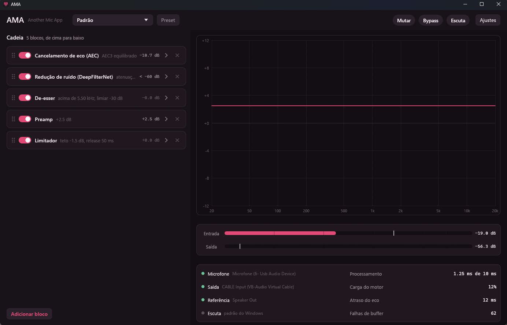

# AMA (Another Mic App)

[English](#english) | [Português](#português)

Made by [@ruptvra](https://buymeacoffee.com/ruptvra).

<a href="https://buymeacoffee.com/ruptvra"></a>



## English

AMA cleans up your microphone on Windows and sends the result to a virtual cable (VB-Cable), so Discord or any other app gets the processed voice.

### What it does

- Removes the echo of your speakers from the mic (WebRTC AEC3). Useful when you play without headphones.
- Removes background noise (DeepFilterNet 3).
- EQ and effects ported from Equalizer APO: preamp, parametric filters, GraphicEQ (15, 31 bands or free points), loudness correction, convolution, delay and a limiter.
- Hosts 64-bit VST2 plugins, with the plugin's own window.
- Blocks can be reordered, turned off or removed. Each chain is saved as a preset.
- Imports and exports Equalizer APO `config.txt` files. Equalizer APO does not need to be installed.

### How it works

AMA reads the mic and a loopback of your speakers through WASAPI at 48 kHz and processes 10 ms frames. The speaker signal is the echo reference. Mic, reference, output and monitor each run on their own thread and talk through lock-free ring buffers. Small clock differences between devices are corrected by resampling. AMA listens for Windows device events, so plugging or unplugging a device reconnects in a fraction of a second.

### Using it

1. Install [VB-Cable](https://vb-audio.com/Cable/).
2. Run `AMA.exe`. In Settings pick your mic and set the output to `CABLE Input`.
3. In Discord, set the input device to `CABLE Output`.

Global hotkeys: `Ctrl+Alt+M` mutes, `Ctrl+Alt+B` bypasses (raw mic). Both can be changed in Settings. Closing the window can send AMA to the tray, where it keeps running.

Files next to the exe: `ama.toml` (settings), `presets\` (one `.toml` per preset) and `ama.log`.

The interface language (English or Portuguese) is set in Settings.

### Building

Rust stable, Windows 10 or 11, 64-bit.

```
cd micclean
cargo build --release
```

### License

GPL-2.0, since the DSP blocks are ported from Equalizer APO.

## Português

O AMA limpa o seu microfone no Windows e manda o resultado para um cabo virtual (VB-Cable), assim o Discord ou qualquer outro programa recebe a voz já tratada.

### O que faz

- Tira do mic o eco das suas caixas de som (WebRTC AEC3). Serve para jogar sem fone.
- Tira o ruído de fundo (DeepFilterNet 3).
- EQ e efeitos portados do Equalizer APO: preamp, filtros paramétricos, GraphicEQ (15, 31 bandas ou pontos livres), loudness correction, convolução, delay e limitador.
- Roda plugins VST2 de 64 bits, com a janela do próprio plugin.
- Os blocos podem mudar de ordem, ser desligados ou removidos. Cada cadeia fica salva como preset.
- Importa e exporta o `config.txt` do Equalizer APO. Não precisa ter o Equalizer APO instalado.

### Como funciona

O AMA lê o mic e um loopback das caixas pelo WASAPI a 48 kHz e processa quadros de 10 ms. O som das caixas serve de referência para o cancelamento de eco. Mic, referência, saída e escuta rodam cada um na sua thread e trocam áudio por buffers circulares sem trava. Diferenças pequenas de relógio entre os aparelhos são corrigidas por reamostragem. O AMA recebe os avisos de dispositivo do Windows, então ligar ou tirar um aparelho reconecta em menos de um segundo.

### Como usar

1. Instale o [VB-Cable](https://vb-audio.com/Cable/).
2. Abra o `AMA.exe`. Em Ajustes escolha o seu mic e deixe a saída em `CABLE Input`.
3. No Discord, coloque o dispositivo de entrada em `CABLE Output`.

Atalhos globais: `Ctrl+Alt+M` muta, `Ctrl+Alt+B` liga o bypass (mic cru). Dá para trocar os dois em Ajustes. Fechando a janela, o AMA pode ir para a bandeja e continuar rodando.

Arquivos ao lado do exe: `ama.toml` (ajustes), `presets\` (um `.toml` por preset) e `ama.log`.

O idioma da interface (português ou inglês) fica em Ajustes.

### Compilar

Rust estável, Windows 10 ou 11, 64 bits.

```
cd micclean
cargo build --release
```

### Licença

GPL-2.0, porque os blocos de DSP vêm do Equalizer APO.
